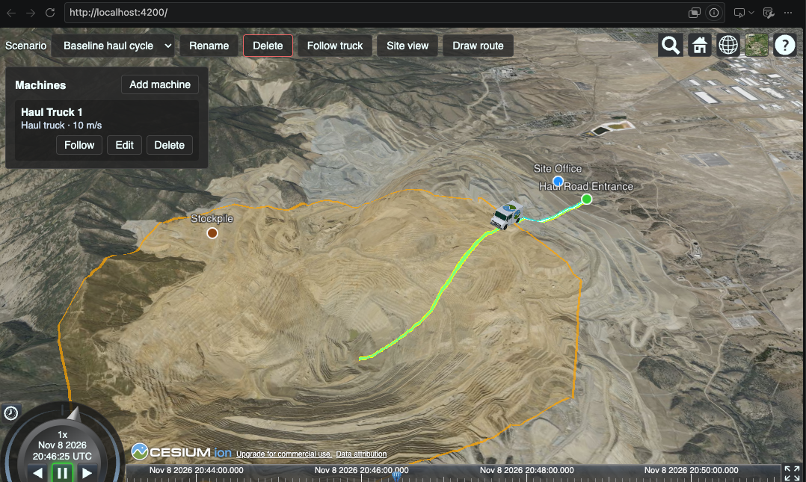
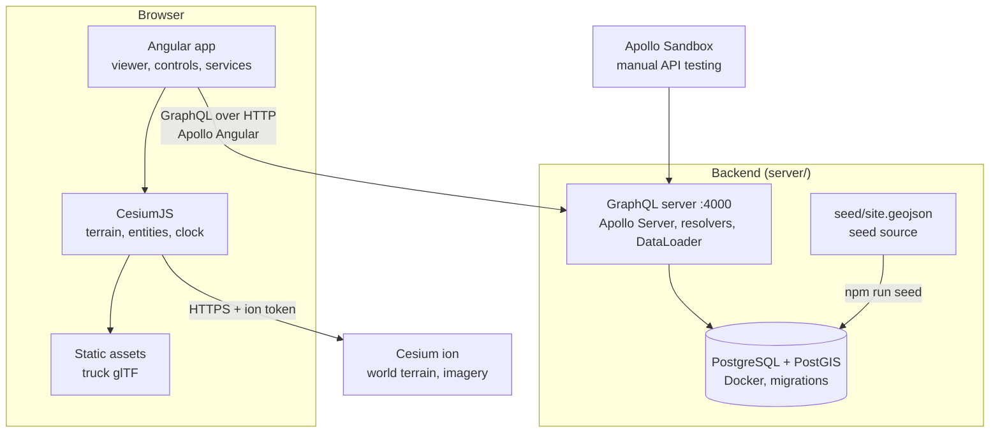

# Jobsite Twin

A prototype construction-site digital twin built with Angular and CesiumJS.



## Features

- **3D world terrain** of a real open-pit mine (Bingham Canyon, Utah) using Cesium World Terrain.
- **Scenarios from a GraphQL API**: pick a scenario, and the app loads its site and machines from the backend, clears the scene, redraws it and restarts the clock. It shows loading and error states, including a clear message when the API isn't running.
- **Site features** from the scenario's site GeoJSON, clamped to the terrain: site boundary, haul road and labeled markers (stockpile, site office, haul road entrance). Click a feature to see its name in the info box. Coordinates are approximate.
- **Animated machines** that drive their routes at their configured speed (the seeded haul truck: 10 m/s). Routes are densified to ~5 m with heights from the terrain (`sampleTerrainMostDetailed`), and each machine faces its direction of travel and leaves a trail. Each machine's full route is drawn as a faint line on the ground, so you can see where it's headed. All machine types currently use the same truck model.
- **Draw route**: toggle draw mode, click the terrain to place waypoints (shown as points with a ground-clamped line), use *Undo* to remove the last one and *Cancel* or Esc to leave. Enter a scenario name, machine name, machine type and speed, then *Save*. This creates a new scenario on the current site through the `createScenario` mutation, selects it and plays it. The form checks for at least 2 points, both names and a speed above 0 before sending, and shows any server error. The coordinate helper is off while drawing.
- **Rename and delete scenarios**: *Rename* edits the name in place (Enter saves, Esc cancels). *Delete* asks for confirmation first, then removes the scenario with its machines, routes and simulation runs, and switches to the first remaining scenario.
- **Machines panel**: lists the loaded scenario's machines with their type and speed. *Follow* puts the camera on a machine; *Edit* changes its name, type and speed (the route stays the same); *Delete* removes it after a confirmation. *Add machine* draws a route the same way as *Draw route*, but adds the machine to the current scenario, so one scenario can run several machines.
- **Timeline playback** that loops over the longest trip; change speed with Cesium's clock controls.
- **View controls**: scenario picker, *Rename*, *Delete*, *Follow truck*, *Site view* and *Draw route* buttons.
- **Coordinate helper** (development builds only): click the terrain to log latitude, longitude and height to the browser console.
- **GraphQL backend** ([`server/`](server/)) for scenarios, machines with routes, and simulation runs, stored in PostgreSQL/PostGIS. The app reads scenarios from it, creates new ones with *Draw route*, renames and deletes them, and adds, edits and deletes their machines; the simulation-run mutations exist in the API but the app doesn't call them yet.


## Architecture



## Tech stack

- [Angular](https://angular.dev) 21 (standalone components, signals)
- [CesiumJS](https://cesium.com/platform/cesiumjs/) 1.146
- [Cesium ion](https://cesium.com/platform/cesium-ion/) for terrain and imagery
- TypeScript 5.9
- [Apollo Angular](https://the-guild.dev/graphql/apollo-angular) 14 + [Apollo Client](https://www.apollographql.com/docs/react) 4 for GraphQL
- [GraphQL Code Generator](https://the-guild.dev/graphql/codegen) (client preset) for typed queries
- [Vitest](https://vitest.dev) for unit tests

**Backend** (`server/`):

- Node.js 22, [Apollo Server](https://www.apollographql.com/docs/apollo-server) 5, [graphql-js](https://github.com/graphql/graphql-js)
- PostgreSQL 17 + [PostGIS](https://postgis.net) 3.5 via [node-postgres](https://node-postgres.com) (`pg`), run locally with Docker Compose
- [DataLoader](https://github.com/graphql/dataloader) for batched queries
- Plain SQL migrations, [tsx](https://tsx.is) to run TypeScript

## Setup

### Prerequisites

- Node.js 22 (Angular 21 requires `^20.19`, `^22.12` or `>=24`)
- npm 11
- A free [Cesium ion](https://ion.cesium.com/signup) account

### Install

```bash
npm install
```

### Cesium ion token

1. In Cesium ion, go to **Access Tokens → Create token**.
2. Keep only read scopes: `assets:read` (and `geocode` if you want the search box).
3. Under **Allowed URLs**, restrict it to `http://localhost:4200`.

The token is embedded in the browser bundle, so treat it as public and keep it restricted.

### Configure the environment

```bash
cp src/environments/environment.example.ts src/environments/environment.ts
```

Put your token in `environment.ts`. It is git-ignored and never committed. `graphqlUrl` points the app at the backend (default `http://localhost:4000/`).

### Backend

The app loads its scenarios from the GraphQL server, so start the backend first. It requires [Docker](https://www.docker.com/products/docker-desktop/) for the local database. The `postgis/postgis` image is amd64-only; on Apple Silicon, Docker Desktop runs it under emulation.

```bash
cd server
npm install
cp .env.example .env    # then set a password in POSTGRES_PASSWORD and DATABASE_URL
npm run db:up           # start PostgreSQL + PostGIS (docker compose)
npm run migrate         # apply migrations/*.sql
npm run seed            # import seed/site.geojson as a scenario with a haul truck
npm run dev             # GraphQL server with reload at http://localhost:4000
```

Open <http://localhost:4000> for the Apollo Sandbox. Example query:

```graphql
{
  scenarios {
    name
    site { name }
    machines { name type speedMps route { seq lat lon } }
    runs { status startedAt durationSec distanceM }
  }
}
```

Other scripts: `npm start` (no reload), `npm run typecheck`, `npm run db:down`. `server/.env` is git-ignored.

To query the database directly, open a `psql` shell in the container with `npm run db:psql`, or run one statement with `npm run db:psql -- -c "SELECT * FROM scenario;"`. Wrap geometry columns in `ST_AsText(...)` to make them readable.

### Run the app

In a second terminal, from the repo root:

```bash
npx ng serve    # or: npm start
```

Open <http://localhost:4200>. If the backend isn't running, the app shows "Can't reach the GraphQL API" with a Retry button.

Other commands: `npx ng build` (production build to `dist/`), `npx ng test` (unit tests), `npm run codegen` (regenerate typed queries in `src/app/graphql/generated/` after changing `src/app/**/*.graphql` or `server/src/schema.graphql`).

## How I built it

- Developed with [Claude Code](https://claude.com/claude-code) in VS Code, guided by a `CLAUDE.md` I kept updated.
- Reviewed every diff before accepting it.
- Built in small PRs, one per step.

## Roadmap

- Record simulation runs from the app (`startSimulationRun` / `completeSimulationRun`)
- Distinct 3D models per machine type
- ESLint
- Playwright end-to-end tests
- GitHub Actions CI

## Credits

- [CesiumJS](https://github.com/CesiumGS/cesium) — Apache License 2.0.
- [Cesium ion](https://cesium.com/platform/cesium-ion/) — Cesium World Terrain and the default Bing Maps aerial imagery, used under the Cesium ion terms of service.
- **CesiumMilkTruck** model © Cesium, from the [Khronos glTF Sample Assets](https://github.com/KhronosGroup/glTF-Sample-Assets/tree/main/Models/CesiumMilkTruck), licensed [CC BY 4.0](https://creativecommons.org/licenses/by/4.0/). Cesium trademarks and logos are excluded from that license.

## License

[MIT](LICENSE). Third-party assets keep their own licenses (see Credits).
